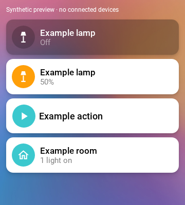

# Kiosk Cards

Reusable Home Assistant dashboard cards with a consistent touch-first design. One frontend module, three cards, no backend integration, button-card templates or card-mod required.



The image uses synthetic entities and is disconnected from devices.

## Install with HACS

1. Open **HACS → ⋮ → Custom repositories**.
2. Add `https://github.com/myevit/kiosk-cards`, category **Dashboard** (internally `plugin`).
3. Download **Kiosk Cards**, then reload the browser/companion frontend.
4. Confirm the JavaScript module resource `/hacsfiles/kiosk-cards/kiosk-cards.js` exists under dashboard resources. HACS normally registers it. Do not add a duplicate.

Manual install: put the release's `kiosk-cards.js` in `/config/www/kiosk-cards/`, then add `/local/kiosk-cards/kiosk-cards.js` as a **JavaScript module**. No Home Assistant restart is needed.

## Entity

```yaml
type: custom:kiosk-entity-card
entity: light.example
```

The icon toggles only `light`, `switch`, `input_boolean` and `fan`. The body opens Home Assistant's normal more-info dialog, retaining brightness and device-specific controls. Locks, covers, alarm panels, scripts, scenes and buttons never receive an implicit toggle or service call. Hold opens more-info by default. Double tap defaults to no action.

ON uses a white tile, black title, gray detail and a colored circle with white glyph. OFF uses a translucent dark tile, theme title color, muted detail and a darker circle with white glyph. State always comes from `hass.states`, not from optimistic animation. Unknown/unavailable entities cannot send commands.

## Explicit action

```yaml
type: custom:kiosk-action-card
entity: script.example
name: Example action
tap_action:
  action: perform-action
  perform_action: script.turn_on
  target:
    entity_id: script.example
  confirmation:
    text: Run the example action?
```

Action cards are momentary commands, not ON/OFF indicators. They use a white command tile and the category accent at rest. There is **no implicit action**; choose `tap_action`. The icon shares the configured body tap unless you override `icon_tap_action`. No last-triggered timestamp is represented as an active state. A name-only card can perform an explicit service with an explicit target.

## Room

```yaml
type: custom:kiosk-room-card
area: example_room
navigation_path: /lovelace/example-room
# Optional explicit sensor/light overrides:
temperature_entity: sensor.example_temperature
occupancy_entity: binary_sensor.example_presence
light_entities:
  - light.example
```

Room cards use HA's cached entity/device/area registries: explicit entity area overrides device area, hidden/disabled entities are excluded, and explicit entity lists take precedence. Temperature, occupancy and light summaries are read-only. Tap navigates **only**; room cards never toggle a whole area. Unavailable lights are counted explicitly, never treated as confirmed off. If multiple eligible sensors exist, use explicit overrides rather than relying on registry order.

## Editing and interactions

All three cards appear in the card picker and include a visual editor built from native `ha-form` and HA entity/icon/area/action selectors. The editor changes configuration only; it never calls devices. Appearance settings are optional and collapsed by default.

For entity/action cards, supported options are `tap_action`, `hold_action`, `double_tap_action`, `icon_tap_action`, `icon_hold_action`, `icon_double_tap_action`. Supported HA actions: `none`, `more-info`, `toggle` (safe domains only), `perform-action`, legacy `call-service`, `navigate`, `url`, `assist`, `fire-dom-event`. Service actions support `data`/legacy `service_data`, `target`, and HA-style `confirmation` (including user exemptions). Confirmation is hosted by HA's native `ha-dialog` through `show-dialog`; no custom overlay and no more-info replacement.

Icon and body are separate keyboard-accessible buttons. Taps and holds are isolated from parent click/ripple handlers. Hold threshold is 500 ms; a configured double tap delays a single tap by 300 ms. During a command, duplicate actions are blocked. A safe toggle waits for the matching incoming entity state **and** service acknowledgment. Explicit momentary actions wait for acknowledgment only, without inventing a lasting ON state. A 12-second watchdog surfaces a concise error and **never retries automatically**. Check the device before retrying after a timeout; the request may still have reached HA.

## Appearance

```yaml
appearance:
  icon_color: "var(--primary-color)"
  background: "rgba(0,0,0,0.3)"
  active_background: white
  radius: 14px
```

Defaults reproduce a 69px entity/room row, 68px action row, 45px circle, 25px glyph, 17px entity title (18px action), 15px detail. Theme font, border radius, text and light accent are inherited. Default category color is teal `#3bc8ce`, independent of `--primary-color`; lights inherit `--accent-color`. If you want primary-color instead, set it explicitly as above. `active_states` can override entity active-state detection; `detail` can override entity/action secondary text. Entity names/icons use HA values unless overridden by `name`/`icon`.

Stable CSS variables: `--kiosk-height`, `--kiosk-radius`, `--kiosk-background`, `--kiosk-active-background`, `--kiosk-icon-color`, `--kiosk-off-title`, `--kiosk-active-title`, `--kiosk-off-detail`, `--kiosk-active-detail`, `--kiosk-off-circle`, `--kiosk-glyph`, `--kiosk-shadow`, `--kiosk-title-size`, `--kiosk-identity-width`. Shadow parts: `surface`, `icon-target`, `icon-circle`, `body-target`, `title`, `detail`, `feedback`. No private HA/button-card class names are styling dependencies.

## Sections layout

The cards report an automatic height and minimum one row, not fixed `rows: 1`. Standard HA `grid_options`, visibility conditions and section columns are retained by the editor. Choose grid columns in HA; avoid forcing a row height shorter than the rendered card.

## Reuse in other custom cards

The source package exports `KioskBaseCard`, concrete cards, types, `kioskStyles` and immutable `designTokens`. Build outputs include an unbundled ES module library with shared Lit dependency and TypeScript declarations. For design-only reuse (without registering cards):

```ts
import { kioskStyles, designTokens } from "@myevit/kiosk-cards/design";
```

Install from this tagged repository (`npm install github:myevit/kiosk-cards#v0.1.0`), or build/pack locally. There is no npm registry publication. Do not load multiple versions of the browser resource simultaneously; registration guards prevent duplicate-definition exceptions, but the first loaded version wins until the page reloads.

## Development and evidence

```sh
npm ci
npm run build
npx playwright install chromium
npm test
python3 scripts/check_public.py
```

Browser tests exercise the real `dist/kiosk-cards.js` with synthetic `hass` objects, command mocks, geometry, gesture separation, editor events, unavailable states, confirmation cancellation and timeout behavior. These are not live-device tests. Native editor selectors and dialog shell have additionally been exercised against HA frontend `20260930.3` in an isolated browser with API/service calls disconnected. Compatibility is not claimed for every historical frontend version.

[HA custom-card documentation](https://developers.home-assistant.io/docs/frontend/custom-ui/custom-card/) · [HACS frontend requirements](https://www.hacs.xyz/docs/publish/plugin/)

MIT; bundled Lit notices are included in [THIRD_PARTY_NOTICES.md](THIRD_PARTY_NOTICES.md).
